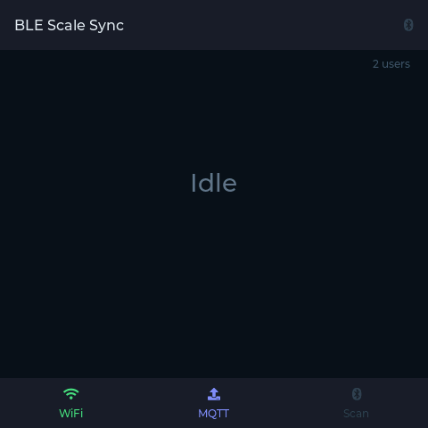

# ESP32 BLE Proxy

An ESP32 near the scale scans for it and relays its advertisements and GATT traffic to BLE Scale Sync over MQTT, so the server needs no Bluetooth adapter. All scale logic stays on the server; how this compares with the other transports is under [Choose a transport](/guide/transports#choose-a-transport).

## Requirements

- A classic ESP32 or ESP32-S3 board from the list below. ESP32-C3 and ESP32-C6 use a different BLE stack in MicroPython and are not tested.
- A 2.4 GHz Wi-Fi network that the ESP32 and BLE Scale Sync both reach.
- An MQTT broker, or the [embedded broker](#embedded-broker) of BLE Scale Sync.
- A USB cable, and Python 3.10 or newer for the flash tools.
- BLE Scale Sync in continuous mode (`runtime.continuous_mode: true` or `CONTINUOUS_MODE=true`). The ESP32 connects to the scale on its own, and only a running continuous-mode app can take that connection; the app warns at startup without it.

### Supported Boards

| Board | Price | PSRAM | Notes |
| --- | --- | --- | --- |
| M5Stack Atom Echo (ESP32-PICO) | about 8 EUR | No | I2S buzzer for beep feedback |
| Generic ESP-WROOM-32 dev board | about 5 EUR | No | No display |
| ESP32-S3-DevKitC | about 12 EUR | Yes | |
| Guition ESP32-S3-4848S040 | about 25 EUR | Yes | 480x480 display with scan status and export results |

| Scale type | Examples | No-PSRAM board | PSRAM board |
| --- | --- | --- | --- |
| Broadcast (reading in the advertisement) | Mi Scale 2, Xiaomi S800 | Yes | Yes |
| GATT (needs a connection) | Yunmai, Inlife, Eufy T9120, QN / Renpho ES-CS20M | No, the connect is skipped | Yes |

A GATT connection is allocated from the ESP-IDF heap, which Wi-Fi and MQTT leave nearly empty on a board without PSRAM. There the firmware refuses the connect instead of crashing, and keeps scanning.



## Flash the Firmware {#flashing-the-firmware}

### 1. Install the Host Tools {#host-tools-install-once}

Clone the repository and change into `firmware/`; every later step runs from there:

```bash
git clone https://github.com/KristianP26/ble-scale-sync.git
cd ble-scale-sync/firmware
```

To use a virtual environment, create and activate it now: `python -m venv venv`, then `source venv/bin/activate` on macOS and Linux, `source venv/Scripts/activate` in Git Bash, or `venv\Scripts\Activate.ps1` in PowerShell. Then install the flash tools:

```bash
pip install -r requirements-flash.txt
```

### 2. Configure {#_1-configure}

```bash
cp config.json.example config.json
```

Edit `config.json`:

```json
{
  "board": null,
  "wifi_ssid": "MyNetwork",
  "wifi_password": "YOUR_WIFI_PASSWORD",
  "mqtt_broker": "192.168.1.100",
  "mqtt_port": 1883,
  "mqtt_user": null,
  "mqtt_password": null,
  "mqtt_tls": false,
  "mqtt_ca_file": null,
  "mqtt_tls_hostname": null,
  "device_id": "esp32-ble-proxy",
  "topic_prefix": "ble-proxy"
}
```

`board` is detected from the chip when it is `null`. Detection cannot tell a WROOM-32 from an Atom Echo, so on a WROOM-32 set `"board": "esp_wroom_32"` or pass `--board esp_wroom_32` to `flash.sh`. Other values: `atom_echo`, `esp32_s3`, `guition_4848`.

### 3. Flash {#_2-flash}

Connect the ESP32 over USB and run the script:

```bash
./flash.sh               # erase, MicroPython, libraries, app
./flash.sh --app-only    # re-upload the app only
./flash.sh --libs-only   # reinstall the MicroPython libraries only
```

The script detects the serial port; override it with `PORT=/dev/ttyACM0 ./flash.sh`. `./flash.sh --help` lists the options.

The Guition 4848 needs a custom LVGL MicroPython build first: `cd ../drivers && ./build.sh guition_4848`, then `cp build/firmware.bin ../firmware/firmware_guition_4848.bin`, see [PORTING.md](https://github.com/KristianP26/ble-scale-sync/blob/main/PORTING.md).

On Windows, run `flash.sh` in Git Bash from [Git for Windows](https://git-scm.com/download/win), with the port from Device Manager under **Ports (COM & LPT)**: `PORT=COM3 ./flash.sh`. WSL works too once the USB device is attached with [`usbipd`](https://learn.microsoft.com/en-us/windows/wsl/connect-usb).

::: details Flash by hand from CMD or PowerShell
`esptool` and `mpremote` run on any OS. Example for an ESP32-S3; download the MicroPython `.bin` for your board from micropython.org first and adjust `--chip`, the file name and `board_*.py` (see `configure_board()` in `flash.sh`):

```powershell
esptool --chip esp32s3 --port COM3 erase-flash
esptool --chip esp32s3 --port COM3 --baud 460800 write-flash 0x0 ESP32_GENERIC_S3-SPIRAM_OCT-20251209-v1.27.0.bin

mpremote connect COM3 mip install "aioble@0.6.2"
mpremote connect COM3 mip install "github:peterhinch/micropython-mqtt@70b56a7a4aaf"
mpremote connect COM3 mip install "github:peterhinch/micropython-async/v3/primitives@68b5f01e999b"

mpremote connect COM3 cp config.json :config.json
mpremote connect COM3 cp boot.py :boot.py
mpremote connect COM3 cp board.py :board.py
mpremote connect COM3 cp board_esp32_s3.py :board_esp32_s3.py
mpremote connect COM3 cp ble_bridge.py :ble_bridge.py
mpremote connect COM3 cp beep.py :beep.py
mpremote connect COM3 cp main.py :main.py
mpremote connect COM3 reset
```
:::

### 4. Verify {#_3-verify}

Open the serial console with `mpremote connect /dev/ttyUSB0 repl`. After Wi-Fi and MQTT come up it prints:

```text
BLE-MQTT bridge ready: ble-proxy/esp32-ble-proxy
```

The status topic shows the same from the broker side:

```bash
mosquitto_sub -h 192.168.1.100 -t 'ble-proxy/esp32-ble-proxy/status'   # prints: online
```

## Configure BLE Scale Sync {#configuring-ble-scale-sync}

```yaml
ble:
  handler: mqtt-proxy
  mqtt_proxy:
    broker_url: 'mqtt://192.168.1.100:1883'
    device_id: esp32-ble-proxy # must match config.json
    topic_prefix: ble-proxy # must match config.json
    # username: myuser
    # password: '${MQTT_PASSWORD}'
```

Restart BLE Scale Sync. `ble-scale-sync setup` (`npm run setup` from a clone) asks for the same values. The broker of the [MQTT exporter](/exporters#mqtt) can serve the proxy too.

`broker_url` takes `mqtts://` for TLS, which covers only the server's own connection. For TLS on the ESP32's connection, set in `config.json`:

- `"mqtt_tls": true`;
- `"mqtt_ca_file"`: a CA certificate file in `firmware/`, which `flash.sh` uploads with the app. Without it the link is encrypted but the broker is not verified;
- `"mqtt_tls_hostname"`: the broker's certificate name, when `mqtt_broker` is an IP address.

### Embedded Broker

Leave out `broker_url` and BLE Scale Sync starts its own broker. Point `mqtt_broker` in the ESP32 `config.json` at this machine's LAN address.

```yaml
ble:
  handler: mqtt-proxy
  mqtt_proxy:
    device_id: esp32-ble-proxy
    topic_prefix: ble-proxy
    embedded_broker_port: 1883 # default
    embedded_broker_bind: 0.0.0.0 # default, all interfaces
    username: myuser # required unless bound to loopback
    password: '${MQTT_PASSWORD}'
```

The schema rejects an embedded broker on a non-loopback address without `username` and `password`. If another broker already holds port 1883, startup fails: set `embedded_broker_port` to a free port such as `1884`, and the same `mqtt_port` in `config.json`. Allow the port through the host firewall.

### Home Assistant Add-on

In the [add-on](/guide/home-assistant-addon#bluetooth-transports), set **Bluetooth transport** to `mqtt-proxy` and pick the broker with **ESP32 proxy broker**:

- `shared` (default) uses the broker of the add-on's MQTT options, which is the Mosquitto broker add-on when MQTT auto-detection is on, even with the MQTT exporter off. Give the ESP32 its own login on that broker (a Home Assistant user, or an entry under `logins` in the Mosquitto add-on) and put it in `mqtt_user` and `mqtt_password` of `config.json`.
- `embedded` starts the broker inside the add-on. **Embedded broker username** and **Embedded broker password** are required, since it listens on the host network. The Mosquitto add-on holds port 1883 on the host, so set **Embedded broker port** to a free one such as `1884` and the same `mqtt_port` in `config.json`.

`mqtt_broker` in `config.json` is the Home Assistant host's IP address for the Mosquitto add-on and for `embedded`, or the broker's own address when you set one by hand. **ESP32 proxy device ID** and **ESP32 proxy topic prefix** must match `device_id` and `topic_prefix`.

### Docker {#docker-deployment}

The container needs no host network, D-Bus mount or `NET_ADMIN`. The repository ships `docker-compose.mqtt-proxy.yml`:

```bash
docker compose -f docker-compose.mqtt-proxy.yml up -d
```

With the embedded broker, publish its port: add `ports: ['1883:1883']` to the service.

## Behavior {#how-it-works}

```text
Scale --BLE--> ESP32 --MQTT--> broker --MQTT--> BLE Scale Sync
```

The ESP32 scans in a loop and publishes what it sees to `scan/results`. An ESP32-S3 scans without pause and publishes every 2 s. A classic ESP32 scans for 5 s (WROOM-32) or 8 s (Atom Echo), publishes, and waits 5 s, so its results arrive every 10 to 13 s; on these shared-radio boards BLE is switched off after each scan so Wi-Fi can recover. The firmware beeps when it sees a scale the server has told it about.

A broadcast scale, such as the Xiaomi Mi Scale 2, is read from its advertisements and never connected, even when it also offers a GATT service. The server learns which scales are broadcast scales while it runs and forgets it on restart, so after a restart the ESP32 can try one connection to a known scale (from `ble.scale_mac` or an earlier reading) before an advertisement identifies it. A scale that accepts the connection is dropped as soon as its characteristics identify it. A scale that never accepts one, such as the Silvergear 108 or the `AAA00x` scales, holds the ESP32 for up to about 30 s with scanning paused, and the first weigh-in after a restart can be lost. If every scale on the proxy is a broadcast scale, set `auto_connect: false` under `mqtt_proxy`.

A GATT scale is connected by the ESP32 itself the moment it sees a known scale's MAC (`auto_connect`, on by default). The ESP32 reports the characteristics, the server subscribes and writes the commands the scale needs, the readings arrive as notifications, and the server sends `disconnect` when the reading is complete. With `auto_connect: false` the server sends `connect` instead, which adds an MQTT round trip that a fast-sleeping scale can miss. What happens if the scale is still on after the reading is under [When a session ends](/guide/transports#when-a-session-ends).

The firmware ends a GATT session on its own and resumes scanning when the link is down, when the server has not engaged with it within 20 s, or after 3 minutes, and prints `GATT session guard: ...` on the serial console.

## MQTT Topics

All topics start with `{topic_prefix}/{device_id}/` (default `ble-proxy/esp32-ble-proxy/`).

| Topic | Direction | Payload |
| --- | --- | --- |
| `status` | ESP32 -> Server | `"online"` / `"offline"` (retained, LWT) |
| `error` | ESP32 -> Server | JSON with `op` (connect, auto-connect, scan, subscribe, write, read, command), `message` and, where it applies, `address` / `uuid` |
| `scan/results` | ESP32 -> Server | JSON array of discovered devices |
| `config` | Server -> ESP32 | Retained JSON: `scales` (MACs), `users`, `passive` (MACs read from advertisements, never connected), `autoConnect` (`false` disables the autonomous connect), `lazy_notify` (`true`: enable a notification only on `subscribe/{uuid}`) |
| `beep` | Server -> ESP32 | Empty, or JSON with `freq` (20 to 4000 Hz), `duration` (1 to 500 ms), `repeat` (1 to 3); values outside are clamped |
| `display/reading` | Server -> ESP32 | JSON with user slug, name, weight, impedance and exporter list |
| `display/result` | Server -> ESP32 | JSON with user slug, name, weight and per-exporter results |
| `connect` | Server -> ESP32 | JSON with `address` and `addr_type` |
| `connected` | ESP32 -> Server | JSON with `address`, the discovered `chars` (uuid and properties), and `autonomous: true` when the ESP32 connected on its own |
| `disconnect` | Server -> ESP32 | Any payload |
| `disconnected` | ESP32 -> Server | Empty |
| `subscribe/{uuid}` | Server -> ESP32 | Empty; enables the notification on that characteristic (with `lazy_notify`) |
| `notify/{uuid}` | ESP32 -> Server | Raw bytes of a notification |
| `write/{uuid}` | Server -> ESP32 | Raw bytes to write |
| `read/{uuid}` | Server -> ESP32 | Empty; triggers a read |
| `read/{uuid}/response` | ESP32 -> Server | Raw bytes read |
| `screenshot` | Server -> ESP32 | Display boards: request a framebuffer dump. Refused (an `error` with `op: "screenshot"`) during a BLE connection |
| `screenshot/info`, `screenshot/{n}`, `screenshot/done` | ESP32 -> Server | Display size and format, the RGB565 framebuffer in numbered chunks, then the chunk count |

The firmware files and what each does are listed in [`firmware/`](https://github.com/KristianP26/ble-scale-sync/tree/main/firmware) in the repository.

## Troubleshooting

### Unlock Write Every 3 s, then "GATT session cap exceeded" After 90 s

The ESP32 connected to a broadcast scale such as the Mi Scale 2. The server drops such a connection, logs `Autonomous connect to Xiaomi Mi Scale 2 (...) ignored: this scale is read from its advertisements, not over GATT` and tells the ESP32 to stop connecting to it; after a restart this can happen once more (see [Behavior](#how-it-works)). If it repeats on every weigh-in, [flash the current firmware](#flashing-the-firmware). If every scale on the proxy is a broadcast scale, set `auto_connect: false` under `mqtt_proxy`.

### ESP32 Shows "online" but Scans Find Nothing

Move the ESP32 closer to the scale; small boards such as the Atom Echo have a short range. Some scales advertise only while the display is lit, so step on the scale during a scan. The first scan after boot can time out after 30 s while the ESP32 is still joining Wi-Fi; later scans arrive at the normal interval.

### `MemoryError` or a Refused GATT Connect on a Board Without PSRAM {#gatt-connect-times-out-or-the-esp32-reboots-classic-esp32-no-psram}

A board without PSRAM has little heap left once Wi-Fi and MQTT run. The serial console prints the ESP-IDF heap before each connect, and a refused connect looks like this:

```text
IDF heap too low for GATT connect: free=<bytes> largest=<bytes> (#139); use an ESP32-S3 / PSRAM board for GATT-connect scales
```

A small `largest` means the board is out of RAM: use a PSRAM board for GATT scales. A healthy `largest` with a connect timeout points at radio contention; move the board closer to the scale. For a `MemoryError` during scans, lower `SCAN_DURATION_MS` in the board's `board_*.py` so a scan collects fewer devices.

### A GATT Scale Is Never Read {#a-gatt-only-scale-never-connects-with-auto-connect}

- Set `ble.scale_mac`. The ESP32 connects only to MACs the server has sent it, and without one the server falls back to a slower host-initiated connect after a few scan cycles.
- Run the server in continuous mode. If the server does not engage with a session, the firmware ends it after 20 s (`GATT session guard: ...`) and the reading is lost.
- If the serial console logs `GATT connect attempt ... failed ... TimeoutError` on every weigh-in, [flash the current firmware](#flashing-the-firmware): it retries a timed-out connect once with the other address type, which a scale with a random address needs.
